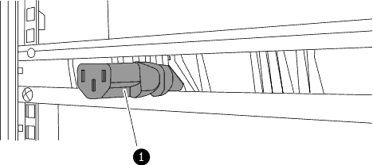
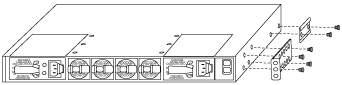
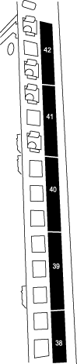
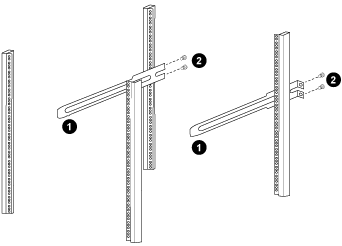
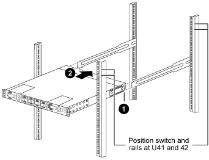
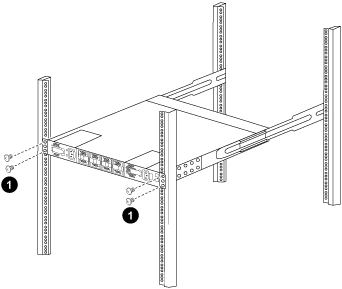

= Einen Cisco Nexus 92300YC Cluster Switch in einem NetApp Schrank installieren
:allow-uri-read: 
:icons: font
:imagesdir: ../media/

[role="lead"]
Je nach Konfiguration kann es erforderlich sein, den Cisco Nexus 92300YC Cluster Switch und das Pass-Through-Panel in einem NetApp Schrank mit den standardmäßigen Halterungen zu installieren, die im Lieferumfang des Switches enthalten sind.

.Bevor Sie beginnen
* Die anfänglichen Vorbereitungsanforderungen, der Inhalt des Kits und die Sicherheitsvorkehrungen in der link:https://www.cisco.com/site/us/en/products/networking/cloud-networking-switches/nexus-9200-series-switches/index.html["Hardware-Installationshandbuch für die Cisco Nexus 9000-Serie"^].
* Für jeden Switch werden die acht 10-32 oder 12-24 Schrauben und Clipmuttern benötigt, um die Halterungen und Gleitschienen an den vorderen und hinteren Gehäusepfosten zu befestigen.
* Cisco Standard-Montagesatz zur Installation des Switches in einem NetApp Schrank.

[NOTE]
====
Die Überbrückungskabel sind nicht im Durchgangskit enthalten und sollten Ihren Schaltern beiliegen.  Falls sie nicht mit den Switches geliefert wurden, können Sie sie bei NetApp bestellen (Teilenummer X1558A-R6).

====
.Schritte
. Installieren Sie die Durchgangsabdeckung im NetApp -Schrank.
+
Das Durchgangspanel-Kit ist bei NetApp erhältlich (Teilenummer X8784-R6).

+
Das NetApp Pass-Through-Panel-Kit enthält die folgende Hardware:

+
** Eine Durchgangs-Blindplatte
** Vier 10-32 x 0,75 Schrauben
** Vier 10-32 Clipmuttern
+
... Ermitteln Sie die vertikale Position der Schalter und der Abdeckplatte im Gehäuse.
+
Bei diesem Verfahren wird die Abdeckplatte in U40 installiert.

... Montieren Sie auf jeder Seite zwei Clipmuttern in den entsprechenden quadratischen Löchern für die vorderen Schrankschienen.
... Zentrieren Sie das Panel vertikal, um ein Eindringen in den angrenzenden Rack-Bereich zu verhindern, und ziehen Sie dann die Schrauben fest.
... Führen Sie die weiblichen Stecker beider 48-Zoll-Überbrückungskabel von der Rückseite des Bedienfelds durch die Bürstenbaugruppe.
+

_(1) Weiblicher Stecker des Überbrückungskabels._

. Die Rack-Montagehalterungen werden am Gehäuse des Nexus 92300YC Switch angebracht.
+
.. Positionieren Sie eine vordere Rackmontagehalterung auf einer Seite des Switch-Gehäuses, sodass die Montageöse mit der Gehäusefrontplatte (auf der Netzteil- oder Lüfterseite) ausgerichtet ist, und befestigen Sie die Halterung dann mit vier M4-Schrauben am Gehäuse.
+

.. Wiederholen Sie Schritt 2a mit der anderen vorderen Rackmontagehalterung auf der anderen Seite des Switches.
.. Installieren Sie die hintere Rackmontagehalterung am Switch-Gehäuse.
.. Wiederholen Sie Schritt 2c mit der anderen hinteren Rackmontagehalterung auf der anderen Seite des Switches.

. Installieren Sie die Clipmuttern in den quadratischen Lochpositionen für alle vier IEA-Pfosten.
+

+
Die beiden 92300YC Switches befinden sich immer in den oberen 2 HE des Schranks RU41 und 42.

. Montieren Sie die Gleitschienen im Schrank.
+
.. Positionieren Sie die erste Gleitschiene an der Markierung RU42 auf der Rückseite des linken hinteren Pfostens, setzen Sie Schrauben mit dem passenden Gewinde ein und ziehen Sie die Schrauben dann mit den Fingern fest.
+

+
(1) Die Gleitschiene wird vorsichtig eingeschoben und an den Schraubenlöchern im Gestell ausgerichtet. (2) Die Schrauben der Gleitschienen werden an den Schrankpfosten festgezogen.

.. Wiederholen Sie Schritt 4a für den rechten hinteren Pfosten.
.. Wiederholen Sie die Schritte 4a und 4b an den RU41-Positionen am Schrank.

. Bauen Sie den Schalter in den Schrank ein.
+
[NOTE]
====
Für diesen Schritt sind zwei Personen erforderlich: eine Person, die den Schalter von vorne stützt, und eine andere, die den Schalter in die hinteren Gleitschienen führt.

====
+
.. Positionieren Sie die Rückseite des Schalters an der RU41-Schiene.
+

+
(1) Beim Hineinschieben des Chassis in Richtung der hinteren Pfosten müssen die beiden hinteren Rack-Montageführungen mit den Gleitschienen ausgerichtet werden.

+
_(2) Den Schalter vorsichtig schieben, bis die vorderen Rack-Montagehalterungen bündig mit den vorderen Pfosten abschließen._

.. Befestigen Sie den Schalter am Gehäuse.
+

+
(1) Während eine Person die Vorderseite des Chassis waagerecht hält, sollte die andere Person die vier hinteren Schrauben an den Gehäusepfosten vollständig festziehen.

.. Wenn das Chassis nun ohne Hilfe gestützt wird, ziehen Sie die vorderen Schrauben an den Pfosten vollständig fest.
.. Wiederholen Sie die Schritte 5a bis 5c für den zweiten Schalter am Standort RU42.
+
[NOTE]
====
Durch die Verwendung des fertig montierten Schalters als Stütze ist es nicht notwendig, den zweiten Schalter während des Montagevorgangs vorne festzuhalten.

====

. Wenn die Schalter installiert sind, schließen Sie die Überbrückungskabel an die Stromeingänge der Schalter an.
. Schließen Sie die Stecker beider Überbrückungskabel an die nächstgelegenen verfügbaren PDU-Steckdosen an.
+
[NOTE]
====
Um die Redundanz aufrechtzuerhalten, müssen die beiden Kabel an verschiedene PDUs angeschlossen werden.

====
. Der Management-Port jedes 92300YC-Switches wird entweder mit einem der Management-Switches (falls bestellt) oder direkt mit dem eigenen Management-Netzwerk verbunden.
+
Der Verwaltungsport ist der obere rechte Port auf der Netzteilseite des Switches. Das CAT6-Kabel für jeden Switch muss nach der Installation der Switches durch das Durchgangspanel geführt werden, um eine Verbindung zu den Verwaltungs-Switches oder dem Verwaltungsnetzwerk herzustellen.

.Was kommt als nächstes
Nachdem die Switches im NetApp-Schrank installiert wurden, kann link:configure-install-initial.html["Konfigurieren Sie den Switch"].
